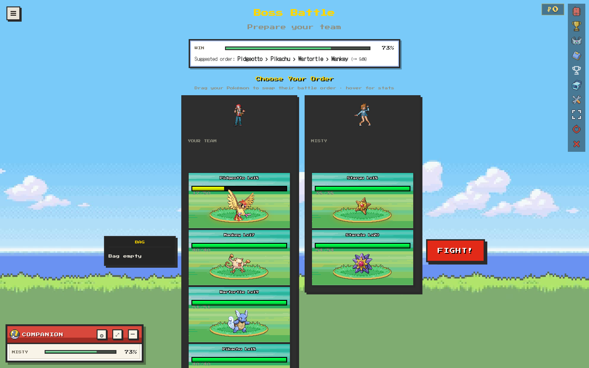
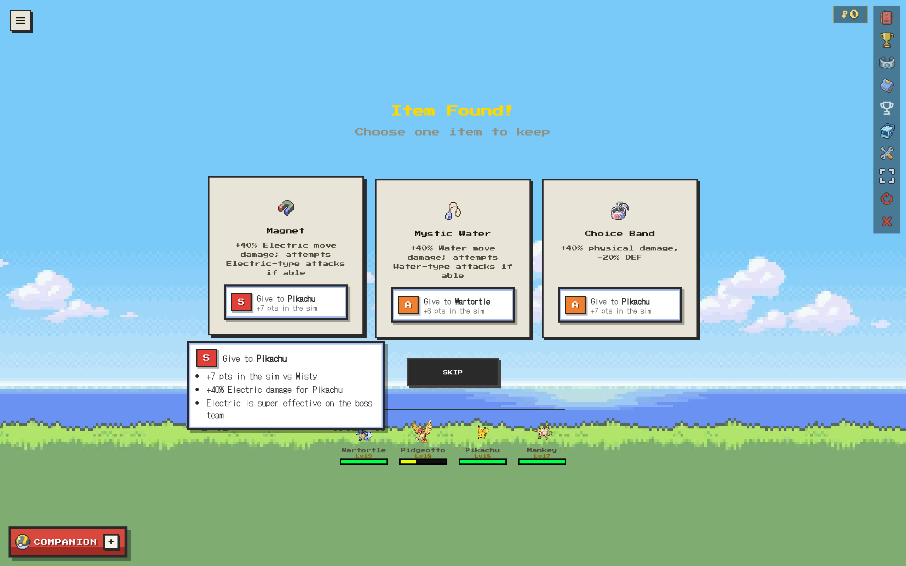
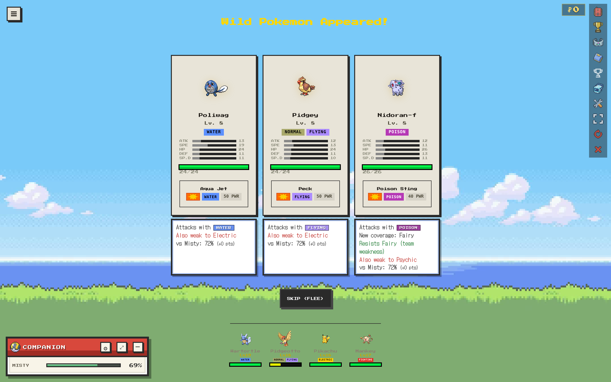
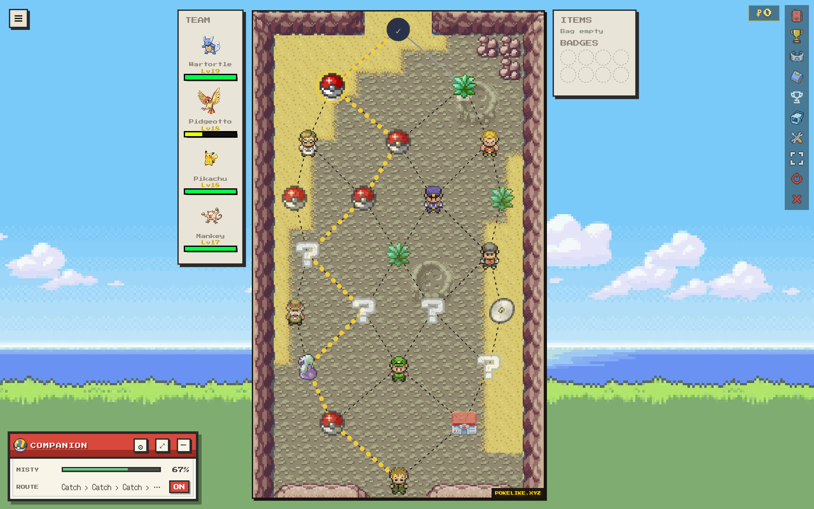
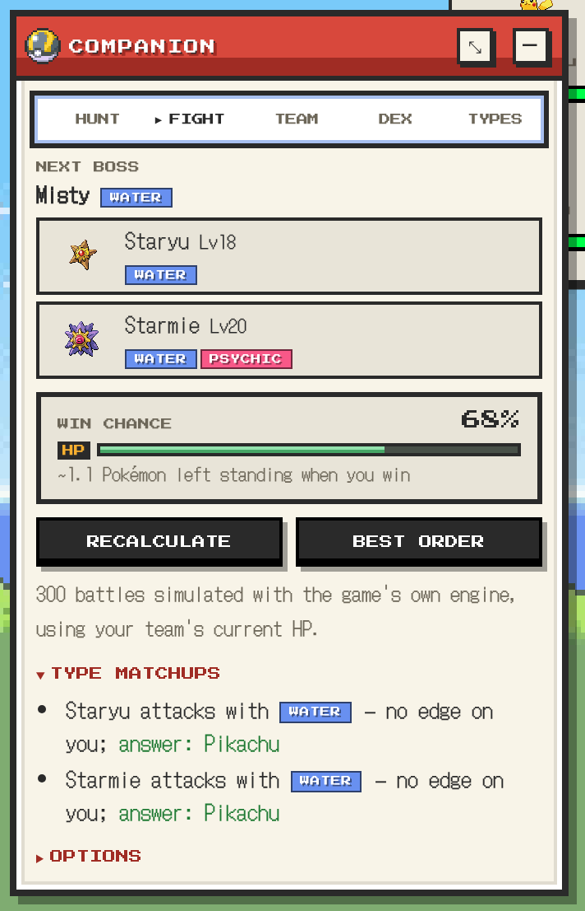
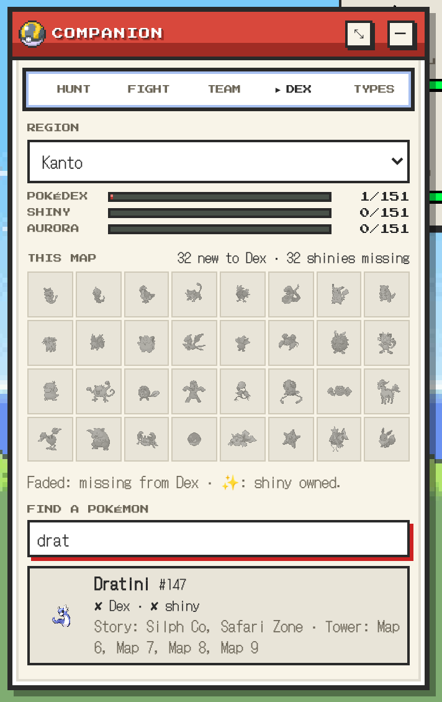

# Pokelike Companion

> 🇧🇷 [Leia em português](README.pt-BR.md)

A free browser extension (Chrome, Edge, Brave, Opera) that adds a helper panel to
[Pokelike](https://pokelike.xyz): boss win chances simulated with the game's own engine, S+ to C grades
for your choices, a Dex tracker, a suggested map route and an optional shiny auto-reroll.

**Unofficial fan project** — not affiliated with Pokelike, Nintendo, Game Freak or The Pokémon Company.

## Install

1. Download this repository (**Code → Download ZIP**) and unzip it somewhere you won't delete.
2. Open `chrome://extensions` (Edge: `edge://extensions`) and turn on **Developer mode**.
3. Click **Load unpacked** and pick the folder that contains `manifest.json`.
4. Open or reload pokelike.xyz. The panel shows up in the bottom-left corner.

To update: replace the files in the same folder, click ↻ on the extension card and reload the game.

## What it does

The panel has two modes (⤢ button in its header):

- **Compact** (default): up to 3 lines that change with the screen — hunt (▶/■ and progress), win chance
  against the next boss (plus the whole league on the Elite Four) and the suggested route on the map.
- **Extended**: every tool, in tabs (Hunt, Fight, Team, Dex, Types).

Inside the game's own screens:

| Screen | What you get |
|---|---|
| **Boss prep** | Win chance, **suggested team order** and, on the Elite Four, how far you usually get in the league (no healing between fights). |
| **Items, relics, stat boosts** | An **S+ to C grade** on each card with who should hold it; hover for every reason. |
| **Catch** | Attack type, new coverage, team weaknesses it covers or stacks, win-chance change, and a **NEW IN DEX / NEW SHINY** badge. |
| **Full team** | A corner badge on each Pokémon: how swapping it for the new one changes the boss fight. |
| **Move Tutor** | A grade on each row: where the stronger move matters most. |
| **Map** | A subtle dotted line with a suggested path to the boss. |

**Hunt tab** — optional shiny auto-reroll: it does what you'd do by hand (R + the left catch node) and stops
by itself on a shiny, an aurora, a **shiny missing from your Dex** or a specific Pokémon. Any key press or
click in the game pauses it. Also shows the real odds, your hunt history and the legendary egg's current
shiny chance.

**Dex tab** — Pokédex / Shiny / Aurora progress per region, what's still missing on the current map, and
where to find any species.

  
  

## How grades work

Each grade adds two things:

1. **Simulation**: the game's battle engine runs the next boss fight with and without the option (same
   battle seeds for every option, so differences come from the option, not luck). If the fight is too
   easy or too hard to compare, one side gets more HP until it's close to 50%.
2. **Synergy**: written rules — type items only help Pokémon of that type (and make them attack with it,
   +40% damage), kit relics count your Pokémon and traits of that type, a SPE boost checks whether you
   start moving before someone on the boss team, and so on.

Bands: **S+** ≥ 14 · **S** ≥ 9 · **A** ≥ 5 · **B** ≥ 1.5 · **C** below. Treat them as advice, not gospel.

## Game mechanics worth knowing

- Each Pokémon attacks with **one type only**: its first non-Normal type (a Pidgey only hits Flying).
- Holding a **type item of its own type** makes a Pokémon switch to that type and hit for +40%.
- **Shiny**: 1% per Pokémon (2% with Shiny Charm, ×2 with the shiny passive, ×2 in Aurora Hunt) — about
  3% per reset on the first catch node.
- **Aurora only exists in Battle Tower / Challenges**: 10% of shinies (20% with the Aurora Charm).
- **Traits** (Battle Tower): 1 point per type per Pokémon (shiny 2, aurora 3); every 2 points = +1 tier.

## Safety

- **Fully off in Ranked and Soul Link.** Ranked records your inputs as anti-cheat; the extension stays away.
- Simulations save and restore the game's RNG seed, so they **never change a real outcome**.
- Hunting only resets an empty run; if your run has progress, it asks first.
- No network requests, no data collection, no accounts — everything runs in your browser.
- Heavy work runs in small slices, so the game never freezes.

## Language

The panel follows the game's language (Portuguese if the game is in Portuguese, English otherwise). You
can change it under **Fight → Options**.

## Support

The extension is free and always will be. If it helps your runs, you can buy me a coffee on
[Ko-fi](https://ko-fi.com/lucajbm) ☕ — totally optional.

## If it breaks

Pokelike updates often and the extension uses the game's internal functions. If something stops working,
the browser console shows `[Pokelike Companion]` messages — please open an issue.
