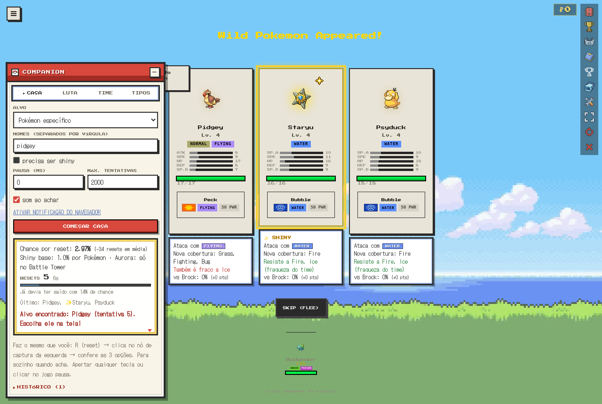

# Pokelike Companion

Extensão de navegador (Chrome, Edge, Brave, Opera) que coloca um painel de apoio
no [Pokelike](https://pokelike.xyz), no estilo dos menus dos jogos de Pokémon.

## Instalar

1. Baixe o repositório (botão **Code → Download ZIP**) e descompacte numa pasta que você não vá apagar.
2. Abra `chrome://extensions` (no Edge: `edge://extensions`).
3. Ligue o **Modo do desenvolvedor** (canto superior direito).
4. Clique em **Carregar sem compactação** e escolha a pasta que tem o `manifest.json`.
5. Abra ou recarregue o pokelike.xyz. O painel aparece no canto inferior esquerdo.

Para atualizar depois: substitua os arquivos e clique em ↻ no card da extensão.

## O que tem

| Aba | O que faz |
|---|---|
| **Caça** | Reset automático até sair um shiny, uma aurora ou um Pokémon específico. Faz o mesmo que você faz na mão (R → nó de captura da esquerda → confere as 3 opções). Para sozinho, toca um som e destaca o card. Mostra a chance por reset, quantos resets em média e o histórico do que você achou. |
| **Luta** | Próximo chefe (líder de ginásio no Story, treinador no Battle Tower), **chance de vitória** calculada com 300 lutas simuladas pelo próprio motor do jogo, **melhor ordem do time** (testa todas as ordens) e duelo de tipos. |
| **Time** | Seu time com HP e o golpe que cada um usa, as fraquezas que o time compartilha, os buracos de cobertura de ataque e os traits (no Battle Tower). |
| **Tipos** | Tabela de tipos: escolha 1 ou 2 tipos e veja o que bate 2x/4x, o que resiste e quanto cada Pokémon do seu time causa. |
| **Notas S+ a C** | Nas telas de **relíquia**, **item** e **boost de atributo**, cada opção ganha uma nota (S+, S, A, B ou C) com os motivos: em quem equipar, com quem combina, quanto melhora a luta contra o próximo chefe. Ex.: *Mystic Water — S+, equipar em Gyarados: +40% no dano Água, ele vai na frente e é quem mais luta.* |
| **Tela de captura** | Embaixo de cada opção: shiny/aurora, tipo de ataque, cobertura nova, se cobre ou piora fraquezas do time, traits que sobem e quanto muda a chance contra o próximo chefe. |

## Coisas do jogo que vale saber

- **Shiny**: 1% por Pokémon (2% com Shiny Charm, ×2 com a passiva de shiny, ×2 no
  desafio Aurora Hunt). O 1º nó tem 3 opções, então dá ~3% por reset.
- **Aurora só existe no Battle Tower / Challenges**: são 10% dos shinies (20% com o
  Aurora Charm). No Story ela nunca aparece, nem caçando.
- **Cada Pokémon ataca com um tipo só**: o primeiro tipo dele que não é Normal.
  Um Pidgey (Normal/Flying), por exemplo, só bate Flying.
- **Traits** (Battle Tower): cada Pokémon dá 1 ponto por tipo (shiny conta 2,
  aurora 3) e cada 2 pontos sobem 1 tier.

## Como as notas são calculadas

A nota soma duas coisas:

1. **Simulação**: o motor de batalha do próprio jogo roda a luta contra o próximo chefe com e
   sem a opção (as mesmas sementes de batalha pra todas as opções, então a diferença vem da
   opção e não da sorte). Se a luta for fácil ou difícil demais pra comparar, a simulação
   aumenta a vida de um dos lados até a chance ficar perto de 50%.
2. **Sinergia**: regras com o motivo escrito. Item de tipo só serve pra quem é daquele tipo
   (e quem segura passa a atacar com ele, +40% de dano); relíquia de kit conta os Pokémon e
   traits do tipo; boost de SPE vê se você passa a atacar antes de alguém do chefe; e assim por diante.

Faixas: **S+** ≥ 14 · **S** ≥ 9 · **A** ≥ 5 · **B** ≥ 1,5 · **C** abaixo. "★ MELHOR" só
aparece quando uma opção ganha com folga. Dá pra desligar na aba **Luta → Dicas na tela do jogo**.

## Desempenho

As simulações rodam em fatias curtas, devolvendo o controle pro navegador entre elas: clicar
num card nunca fica esperando o cálculo, e sair da tela cancela o que estava sendo calculado.
O espaço das dicas é reservado no mesmo instante em que o jogo desenha os cards, então nada
pula de lugar embaixo do mouse.

## Segurança

- **Fica desligado no modo Ranked e no Soul Link.** O Ranked grava seus inputs
  como anti-cheat, e a extensão não mexe em nada lá.
- As simulações salvam e restauram a seed do jogo, igual às simulações internas do
  próprio Pokelike. Elas **não mudam o resultado** das suas lutas.
- A caça só reseta uma run vazia. Se a run já tiver progresso, ela pergunta antes.
  Qualquer tecla ou clique seu no jogo pausa a caça na hora.
- Tudo roda local. A extensão não manda nada pra lugar nenhum.

## Se parar de funcionar

O Pokelike atualiza com frequência. A extensão usa funções internas do jogo
(`runBattle`, `executeResetRun`, `campaignGymTeam`...). Se alguma for renomeada,
o console mostra `[Pokelike Companion] jogo não carregou as funções esperadas`.

## Ícones

O ícone da extensão (`icons/`) é uma Ultra Ball em pixel art própria, gerada por
`tools/make_icons.py`: edite a grade 16×16 do script e rode `python3 tools/make_icons.py`
(precisa do Pillow). A Ultra Ball do cabeçalho do painel é carregada do próprio site
do jogo enquanto você joga, e não fica guardada aqui.
